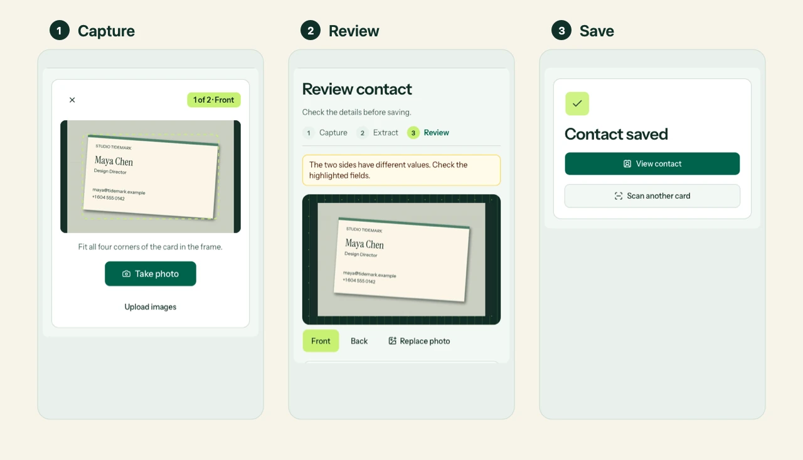

# CardTuck


CardTuck turns the business cards you pick up into contacts you can use. Scan a card with your phone or upload photos, check the extracted details, and save the contact to export or sync later.

[Open CardTuck](https://cardtuck.app/) · [Run locally](#run-locally) · [Add to your phone](#add-a-contact-to-your-phone) · [Deploy on a server](#deploy-on-a-server)

## From card to contact



1. **Capture.** Photograph the front and optional back, or upload a batch and pair the images.
2. **Review.** Correct any extracted fields before saving. You can also enter a contact manually.
3. **Save.** Tag contacts, export vCards, or sync them to an address book over CardDAV.

Screenshots use a fictional contact.

## Get the source

On [GitHub](https://github.com/NH-00/cardtuck), choose **Code → Download ZIP** and extract it, or clone the project:

```sh
git clone https://github.com/NH-00/cardtuck.git
cd cardtuck
```

If you downloaded a ZIP, open a terminal in the extracted folder and continue below.

## Run locally

Use [Node.js 24 LTS](https://nodejs.org/en/download) and its bundled npm. The examples use a macOS or Linux shell. On Windows, use a Linux shell through WSL. The commands run the project's pinned pnpm version through npm.

1. Install the dependencies and create your local configuration **once** in a fresh copy:

   ```sh
   npm exec --yes --package pnpm@11.0.8 -- pnpm install --frozen-lockfile
   cp .env.example .env
   printf '\nAPP_SECRET=%s\n' "$(openssl rand -hex 32)" >> .env
   ```

   Keep `APP_URL=http://127.0.0.1:3000`. Keep `.env` private. Use `VISION_PROVIDER=ollama` in `.env` to try manual entry without a paid reader. If Ollama is stopped, the app logs a reader warning and still starts.

2. Start CardTuck:

   ```sh
   npm exec --yes --package pnpm@11.0.8 -- pnpm dev
   ```

3. Open [http://127.0.0.1:3000](http://127.0.0.1:3000). Click **Sign in** and enter an email address. With SMTP unset in local development, open the sign-in URL printed in the terminal running CardTuck. The link expires after 15 minutes.

4. On **Scan**, choose **Enter contact manually** to try a fictional name and email without using the camera or a model. Click **Save contact → View contact → Download vCard**. Open **Contacts** any time to find saved entries.

The local app creates its database at `data/local.db` and applies migrations automatically. Stop it with **Ctrl+C** and use the same start command to resume. The browser camera works on loopback or a trusted HTTPS address. To use CardTuck from your phone, open your HTTPS deployment.

## Read business cards

The local Ollama route uses your computer's hardware and requires no paid API key. Install [Ollama](https://ollama.com/download), start its app or service, and download a vision model. If the server is stopped, run `ollama serve` in a separate terminal first.

```sh
ollama pull llama3.2-vision
```

The default 11B model takes several GB of disk and needs enough memory to run. Check the [model listing](https://ollama.com/library/llama3.2-vision) before downloading. Set these values in `.env` and restart CardTuck:

```dotenv
VISION_PROVIDER=ollama
OLLAMA_BASE_URL=http://127.0.0.1:11434
OLLAMA_MODEL=llama3.2-vision
```

For a different vision-capable Ollama model, set `OLLAMA_MODEL` to the name shown by `ollama list`. For a hosted provider, select `openai`, `anthropic`, `gemini`, or `custom`, then set that provider's key and model in `.env`. See the settings in [`.env.example`](.env.example). Hosted services can have usage charges. CardTuck sends images selected for reading to the configured provider.

To scan, use **Scan → Use camera** or **Upload images**. Pair front and back photos if needed, read the card, correct the fields, and save. The **Keep card photos with this contact** checkbox starts off. You can remove retained images from a saved contact later.

## Add a contact to your phone

Open a saved person in CardTuck and tap **Add to Contacts**. Install the matching helper once from **One-time setup**. Both helpers are free and open the phone’s editor for you to confirm the save. The handoff includes one contact at a time and leaves out card photos and tags.

- **iPhone:** In Shortcuts, add **CardTuck Add Contact** and keep that name. Open the contact in Safari and use **Add to Contacts**. The shortcut fills the name, company, phone, and email. For structured job title, website, and address fields, use the vCard.
- **Android:** Install **CardTuck Contacts** from the APK and open the contact in Chrome. Its helper opens Android’s contact editor without Contacts or network permissions. Follow the [Android build steps](mobile/android/README.md) to sign your own APK for distribution.

[Download vCard](#import-a-vcard) is available on both phones and on desktop.

## Import a vCard

1. In CardTuck, open **Contacts**. Find the person and open their saved entry. After a scan, **View contact** opens that same entry.
2. Click **Download vCard**. This downloads a `.vcf` file for that person. Repeat for each person you want to add.
3. Import it in your contacts app:
   - **iPhone:** Tap the `.vcf` attachment in Mail or Messages, then review and add the person. [Apple’s iPhone instructions](https://support.apple.com/en-gb/guide/iphone/iph356499f31/ios)
   - **Mac:** Open Contacts and choose **File → Import**. Select the file, then review and add it. [Apple’s Mac instructions](https://support.apple.com/guide/contacts/import-contacts-adrbk1457/mac)
   - **iCloud Contacts:** On a tablet or computer, open [iCloud Contacts](https://www.icloud.com/contacts/). Choose **Add (+) → Import Contact** and select the file. With iCloud Contacts enabled on your devices, the entry syncs through your Apple Account. [Apple’s iCloud instructions](https://support.apple.com/en-lk/guide/icloud/mmfba748b2/icloud)
   - **Android:** In Google Contacts, choose **Organize → Import from file**, pick the account, and select the `.vcf`. [Google’s Android instructions](https://support.google.com/contacts/answer/15147365?co=GENIE.Platform%3DAndroid&hl=en)

CardTuck also supports sending a saved entry to a configured CardDAV address book via **Sync contact**. Ask the operator to set `CARDDAV_ALLOWED_ORIGINS` to the exact, trusted server origins. Then configure your book under **Account → Address books** and choose a destination on the contact. Use the collection URL supplied by your provider. The Apple Shortcut and vCard import routes require no Apple Account credentials in CardTuck.

## Deploy on a server

Use a Linux host with Docker Engine, the Docker Compose plugin, a persistent volume, and a trusted HTTPS URL. An existing server can run the app. Choose your own hosting, email delivery, and card reader based on your budget.

1. Copy `.env.example` to `.env`. Set `APP_URL` to the exact public HTTPS origin and generate a persistent `APP_SECRET` with `openssl rand -hex 32`.
2. Set a strong `POSTGRES_PASSWORD` and a matching `DATABASE_URL`. For a new deployment, set `POSTGRES_USER=cardtuck`, `POSTGRES_DB=cardtuck`, and use `postgresql://cardtuck:<URL-encoded-password>@db:5432/cardtuck`. On existing deployments, preserve the database name, user, and Compose volume. The Compose file starts the database and keeps its files in a named volume.
3. Set `AUTH_ALLOWED_EMAILS` to the people allowed to sign in, and set `AUTH_ALLOW_REGISTRATION=true` while provisioning their accounts. Production registration is opt-in. Set `SMTP_HOST`, `SMTP_PORT`, `SMTP_USER`, `SMTP_PASSWORD`, and `SMTP_FROM` for your email delivery provider. A production instance delivers magic links by email. [Resend SMTP instructions](https://resend.com/docs/send-with-smtp)
4. Choose and configure a vision provider. From inside Docker, `127.0.0.1` refers to the app container. If you host Ollama separately, set `OLLAMA_BASE_URL` to the address reachable from the app container.
5. Build and start the services:

   ```sh
   docker compose -f docker-compose.production.yml up -d --build
   docker compose -f docker-compose.production.yml ps
   ```

6. Point your HTTPS reverse proxy at `127.0.0.1:7658` on the server. For example, with Caddy on the same host:

   ```caddyfile
   cards.example.com {
       reverse_proxy 127.0.0.1:7658
   }
   ```

7. From a phone, open the HTTPS URL, sign in from your real inbox, and test capture, review, and export with a fictional card. Back up and test restoration of PostgreSQL. Once the permitted accounts exist, you can also set `AUTH_ALLOW_REGISTRATION=false` and restart the app to close registration.

Check startup and migrations with `docker compose -f docker-compose.production.yml logs app`. If sign-in redirects to the wrong address, check that `APP_URL` matches the address in the browser.

## Account privacy

CardTuck signs users in with a time-limited link. The server associates contacts, tags, photos, and address book settings with the verified account’s internal ID. A CardTuck user can see and manage data owned by that account. A self-hosting operator controls the server, database and backups.

`APP_SECRET` must be persistent. It protects sessions and encrypts saved CardDAV passwords. Preserve it when restoring a backup. If it is replaced, sign in again and re-enter any saved CardDAV credentials. The app migrates legacy plaintext CardDAV passwords in the live database on startup. Existing copies in backups follow the operator’s retention policy.

See [SECURITY.md](.github/SECURITY.md) for private reporting, [CONTRIBUTING.md](.github/CONTRIBUTING.md) for development, and the [Code of Conduct](.github/CODE_OF_CONDUCT.md) for community participation.

## Development

Run `pnpm typecheck`, `pnpm test`, and `pnpm build` after configuring the local `.env`. Use the pinned pnpm version in `package.json`. The build assembles a standalone package in `.next/standalone`.

## License and attribution

CardTuck uses the [MIT License](LICENSE). It is based on [QardQntac](https://github.com/Occitanie-Open-Source-OCCOS/QardQntac) snapshot at commit `67b5677ae058284a5c6c51848421b395edc0e07f`. The license keeps the original 2026 copyright notice for Occitanie Open Source (OCCOS). The Instrument Sans and Instrument Serif font notices are in `public/fonts/CardTuck`.
